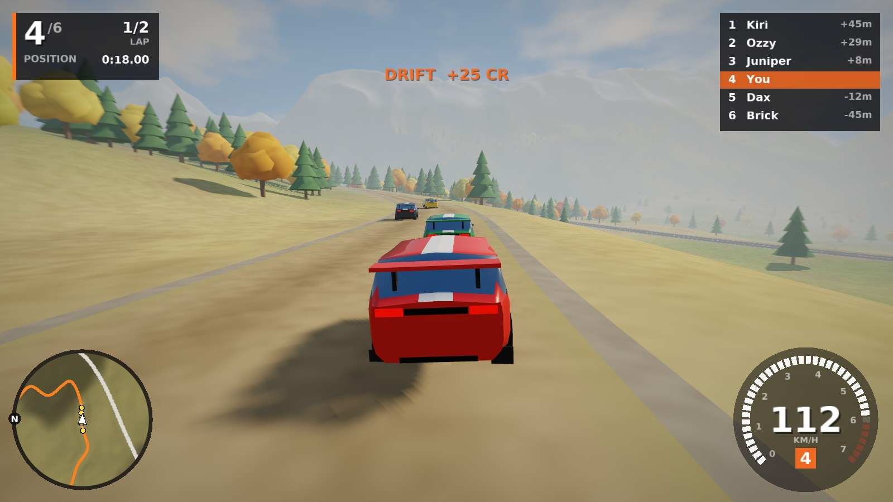
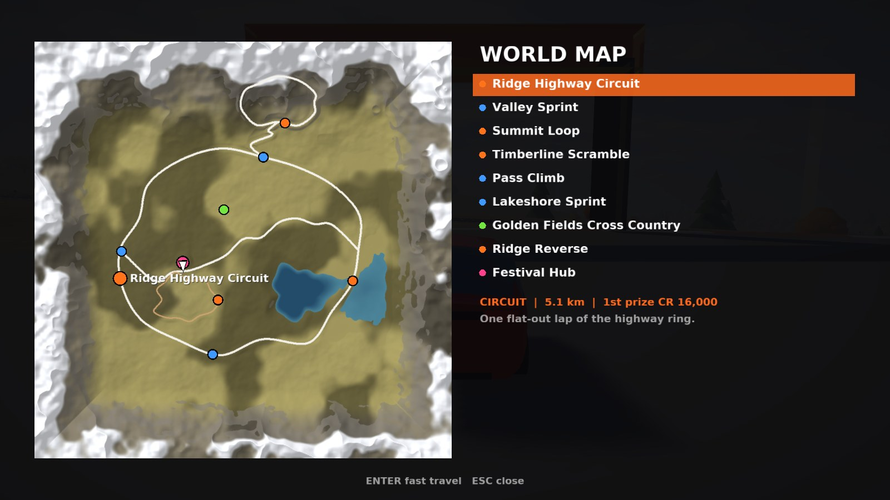

# Ridgeline

**A free, open-source open-world festival racer for Linux.** Drive anywhere across a procedurally generated autumn valley, race AI drivers on highways, mountain passes, dirt trails and open fields, earn credits, and buy and paint new cars at the festival dealership.

Written in C++17 with **SDL3** and OpenGL 3.3. No engine, no downloaded assets: every car, tree, road and mountain is generated in code, in a chunky early-2000s console style.


| | |
|---|---|
|  |  |
|  |  |

## Features

- **Open world**: a 3 × 3 km valley with rolling hills, a lake with a causeway, snow-capped mountains, about 25,000 autumn and pine trees, and over 10 km of roads you can leave whenever you want.
- **8 race events** against 5 AI drivers: circuits, point-to-point sprints, a mountain climb, a dirt-trail scramble and an off-road cross-country race through checkpoints.
- **Smart bots**: they brake for corners based on the road's curvature, overtake by changing lanes, recover when stuck, and use light rubber-banding so races stay close. Your opponents always drive cars from your car's class.
- **10 fictional cars** in 5 classes (D, C, B, A, S): hatchbacks, a rally car, a muscle car, an off-road SUV, sports coupés, mid-engine supercars, a V12 GT and a hypercar. Each has its own power, weight, gearing, grip, drivetrain (FWD/RWD/AWD) and off-road ability.
- **Economy**: win credits from race prizes (top 3 pay out, everyone else gets a participation bonus) and from **drift chains** and **jumps** anywhere in the world.
- **Dealership and garage**: buy cars, choose from 12 paint colours, toggle racing stripes and switch between the cars you own.
- **Driving physics**: tyre slip and grip limits, weight transfer, a 6-speed automatic gearbox, handbrake drifts, jumps and landings, grip that changes between asphalt, dirt, grass and water, and collisions with trees, rocks and other cars. Traction control and a stability assist are on by default and can be turned off.
- **Graphics**: shadow mapping, sky with drifting clouds, distance and height fog, glossy paint reflections, animated water, trees that sway in the wind, speed-based motion blur, MSAA and tone mapping.
- **HUD**: rev-light speedometer, rotating minimap with route and opponents, live race standings, world map with fast travel.
- **Procedural audio**: an engine synthesised from RPM, throttle and cylinder count, tyre squeal, wind, impact sounds and UI beeps.
- **Keyboard and gamepad** (Xbox, PlayStation, Switch Pro and other SDL-supported controllers), with hot-plugging.
- Saves progress automatically.

## Install

```bash
git clone https://github.com/rxvy-dev/ridgeline.git
cd ridgeline
./install.sh
```

That's it. The installer:

1. Detects your distro and installs build tools with your package manager (it asks for your password through `sudo` or `doas`).
2. Uses your distro's SDL3 package if it has one. If not, it downloads SDL3 3.2 and builds it from source, then bundles it with the game, so it works on older distros too.
3. Builds the game and installs it to `~/.local` (no root needed), with an app-menu entry and an icon.

Then launch **Ridgeline** from your app menu, or run `ridgeline` in a terminal.

**Supported package managers:** `pacman` (Arch, Manjaro, EndeavourOS, CachyOS), `apt` (Debian, Ubuntu, Mint, Pop!_OS), `dnf` (Fedora, Nobara), `zypper` (openSUSE), `xbps` (Void), `emerge` (Gentoo), `apk` (Alpine), `eopkg` (Solus). On NixOS, run it inside `nix-shell -p cmake gcc gnumake pkg-config git sdl3`. On any other distro it works as long as a C++17 compiler, CMake and git are installed.

### Installer options

| Command | What it does |
|---|---|
| `./install.sh` | Install for your user into `~/.local` |
| `./install.sh --system` | Install for everyone into `/usr/local` |
| `./install.sh --prefix DIR` | Install into a custom directory |
| `./install.sh --no-deps` | Don't touch the package manager |
| `./install.sh --bundle-sdl` | Always build and bundle SDL3, even if your distro has it |
| `./install.sh --uninstall` | Remove the game (add `--system` or `--prefix` if you used them) |

### Build manually

```bash
# needs: a C++17 compiler, cmake >= 3.16, SDL3 >= 3.2 development files
cmake -S . -B build -DCMAKE_BUILD_TYPE=Release
cmake --build build -j
./build/ridgeline
```

## Controls

| Action | Keyboard | Gamepad |
|---|---|---|
| Accelerate | `W` / `↑` | Right trigger |
| Brake / reverse | `S` / `↓` | Left trigger |
| Steer | `A` `D` / `←` `→` | Left stick |
| Handbrake | `Space` | `A` / `✕` |
| Start event / enter hub | `Enter` | `Y` / `△` |
| Change camera (chase far, chase near, hood, bumper) | `C` | `RB` / `R1` |
| Look back | hold `B` | hold `B` / `○` |
| Reset to road | `R` | `X` / `□` |
| World map | `M` / `Tab` | `Back` / `Select` |
| Pause menu | `Esc` | `Start` |
| Fullscreen | `F11` | |
| Screenshot (saved next to your save file) | `F12` | |

Menus: arrow keys or D-pad to move, `Enter` or `A` to select, `Esc` or `B` to go back, `←` `→` to change values and paint colours, `X` to toggle stripes in the garage.

## How to play

- You start at the **Festival Hub** (pink beacon) with **CR 25,000** and a Kito Pulsar hatchback.
- **Events** are the tall coloured light beams: orange for circuits, blue for sprints, green for cross-country. Drive into one, stop, and press `Enter` to race. You can also fast-travel to any event from the **World Map**.
- Finish **1st, 2nd or 3rd** to win the event's prize. Your best result for each event is shown on the map.
- **Drift** (handbrake into a corner and hold the slide) to build a chain. Keep sliding to raise the multiplier. Stop for a moment to bank it as credits. Crashing breaks the chain.
- **Jumps**: stay in the air for more than half a second to earn credits.
- Spend credits at the **Dealership** (pause menu, or drive into the hub and press `Enter`). Faster cars put you up against faster opponents, because bots always come from your car's class.
- Fell in the lake or stuck in the trees? Press `R`.

### Events

| Event | Type | Notes |
|---|---|---|
| Ridge Highway Circuit | Circuit, 1 lap | The fast highway ring around the valley |
| Ridge Reverse | Circuit, 1 lap | The same ring, counter-clockwise |
| Valley Sprint | Sprint | West to east across the valley floor |
| Lakeshore Sprint | Sprint | The southern highway past the lake |
| Summit Loop | Circuit, 2 laps | A twisting mountain loop up north |
| Pass Climb | Sprint | Switchbacks up to the summit |
| Timberline Scramble | Circuit, 2 laps | A dirt trail through the forest; off-road cars do well here |
| Golden Fields Cross Country | Cross-country | Checkpoints through open meadows |

### Cars

| Car | Class | Price | Drive | Character |
|---|---|---|---|---|
| Kito Pulsar 1.6 | D | starter | FWD | Light, forgiving hatchback |
| Corvo Rallye 2.0 | D | 18,000 | AWD | Rally hatch, great on dirt |
| Bravado Stallion 5.0 | C | 36,000 | RWD | V8 muscle, loves to slide |
| Nordwind Ridgeback TR | C | 42,000 | AWD | Heavy off-roader |
| Kestrel GT-S | B | 64,000 | RWD | Balanced sports coupé |
| Ardent Mantis RT | A | 118,000 | RWD | Brutal front-engine GT |
| Vespera 7 Spyder | A | 142,000 | RWD | Mid-engine, sharp handling |
| Aurex Corsa R | A | 168,000 | AWD | Mid-engine, all-weather grip |
| Strada Rossa V12 | S | 360,000 | RWD | V12 grand tourer |
| Tempest Vortex | S | 1,150,000 | AWD | 880 kW hypercar |

All makes and models are invented for this game.

## Settings

Speed units (km/h or mph), motion blur, shadows, anti-aliasing (off, 2x, 4x, 8x MSAA), draw distance, fullscreen, V-Sync, volume, and driving assists. If the game runs slowly, turn shadows off, lower the draw distance and anti-aliasing.

## Requirements

- Linux on x86_64 or ARM64, with X11 or Wayland
- A GPU with **OpenGL 3.3** (any GPU from about the last 12 years, including Intel integrated graphics with Mesa)
- About 200 MB of RAM

Your save file and screenshots are in `~/.local/share/rxvy/ridgeline/`.

## Troubleshooting

- **"Could not start the game / OpenGL 3.3"**: update your Mesa or GPU drivers. In a VM, enable 3D acceleration.
- **Black window or crash on Wayland**: try `SDL_VIDEO_DRIVER=x11 ridgeline`.
- **No sound**: SDL3 picks PipeWire, PulseAudio or ALSA automatically. Try `SDL_AUDIO_DRIVER=pulseaudio ridgeline`.
- **SDL3 build failed in the installer**: install your distro's X11/Wayland/Mesa *development* packages (the installer prints the list) and run `./install.sh` again, or use `--bundle-sdl`.
- **`ridgeline: command not found`**: add `~/.local/bin` to your `PATH`, or start it from the app menu.

## Project layout

```
src/
  main.cpp       command line and entry point
  game.*         state machine, menus, races, camera, HUD, saving
  world.*        terrain, roads, forests, lake, festival hub, map texture
  cars.*         car database and procedural car and wheel meshes
  vehicle.*      car physics (tyres, gearbox, terrain, collisions)
  race.*         events, routes, AI drivers, progress tracking
  render.*       shaders, meshes, instancing, shadow map, post-processing
  shaders.h      all GLSL shaders
  hud.*          2D drawing and text
  audio.*        procedural engine and effects synth
  gl.*           tiny OpenGL 3.3 function loader
  font_atlas.h   embedded font (generated by tools/gen_font.py)
install.sh       cross-distro installer
packaging/       .desktop entry and icon
```

The world is generated from a fixed seed, so everyone drives the same valley. Developer flags (`ridgeline --help`) can jump straight into a scene, fast-forward the simulation and save screenshots. `--scene bench` runs every car around a route with the AI and prints lap statistics, which is useful for tuning physics.

## Contributing

Pull requests are welcome: new cars (add an entry to `kCars` in `src/cars.cpp`), new events (`buildEvents` in `src/race.cpp`), new roads (`World::generate`), better physics, sound or visuals.

## License

MIT, see [LICENSE](LICENSE). The embedded font is DejaVu Sans Bold (Bitstream Vera / DejaVu license).

Ridgeline is an independent fan project inspired by open-world festival racing games. It is not affiliated with, endorsed by or connected to any commercial racing game, publisher or car manufacturer, and it contains no assets from any of them.
