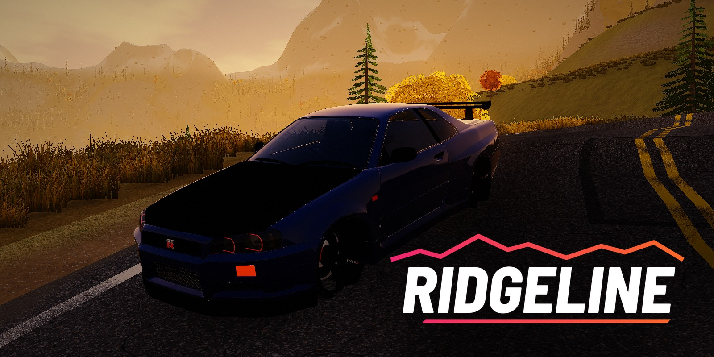
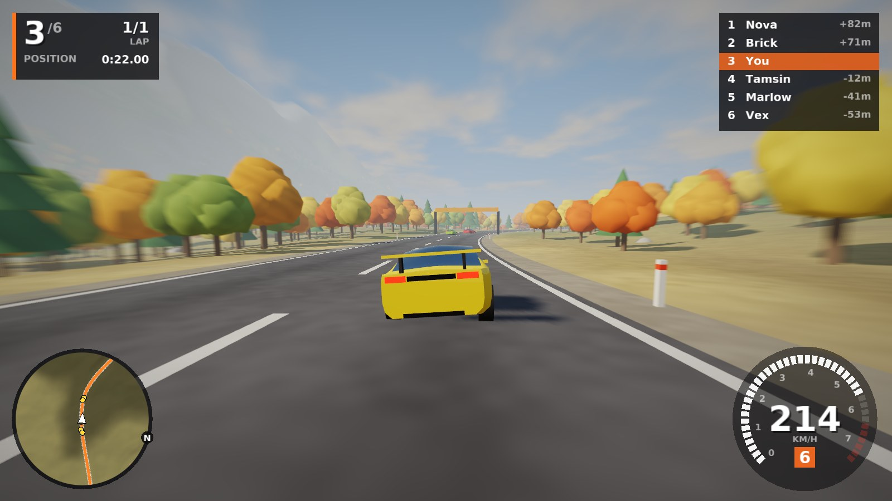
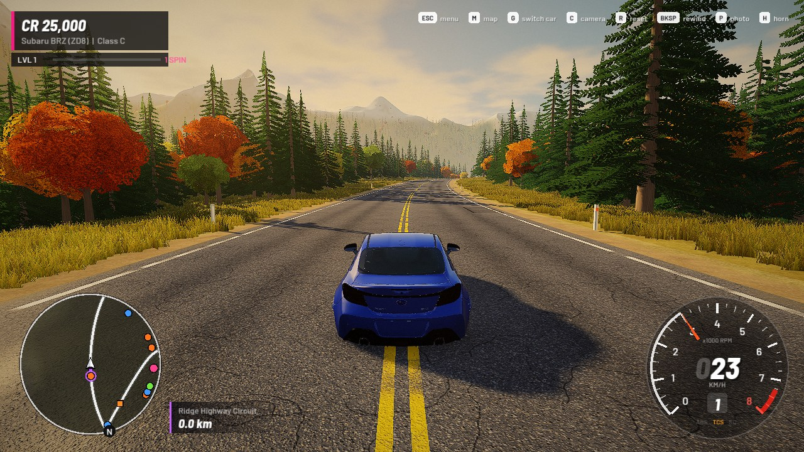
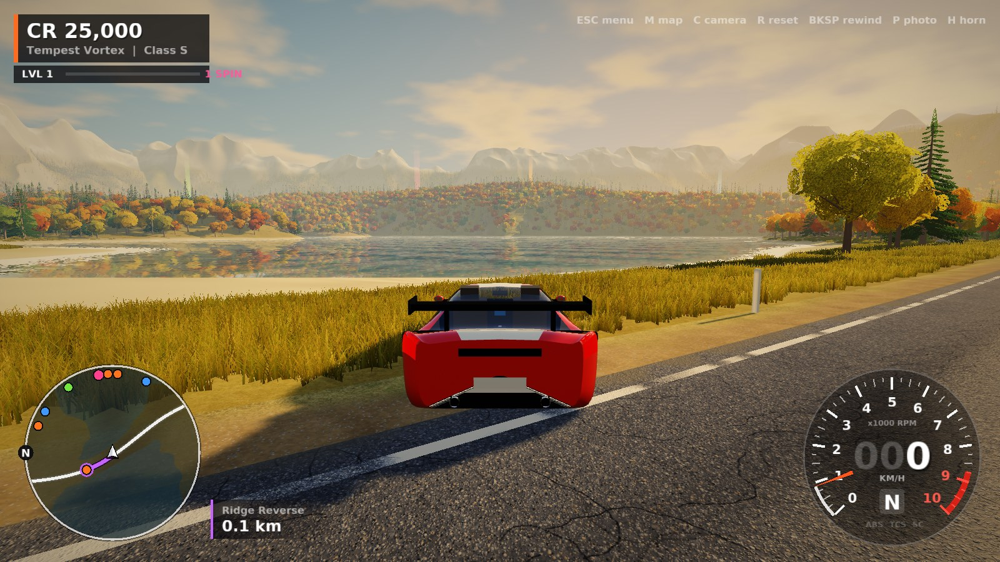
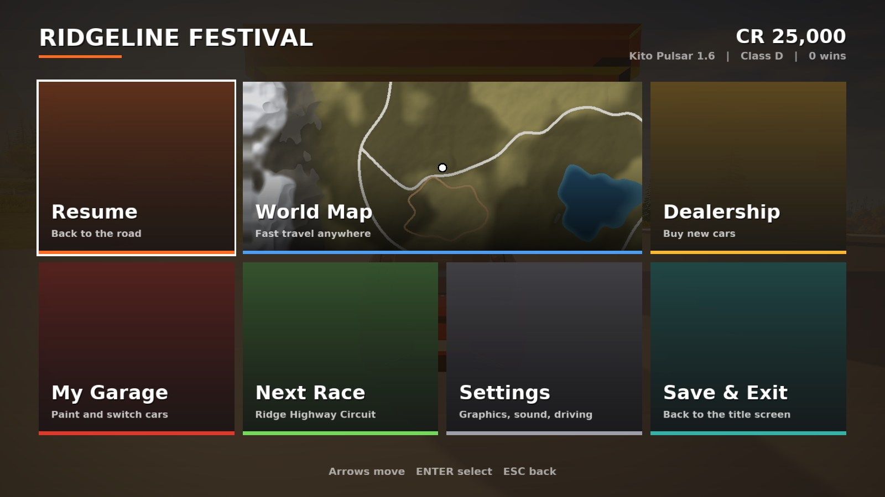
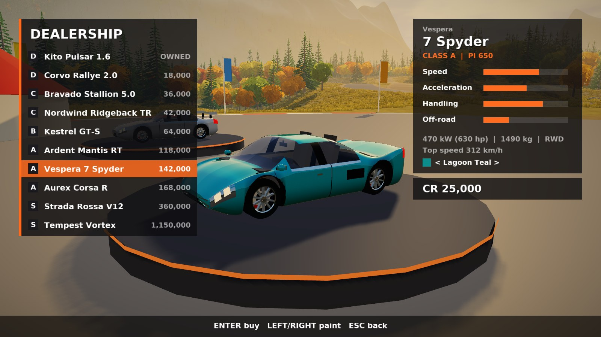
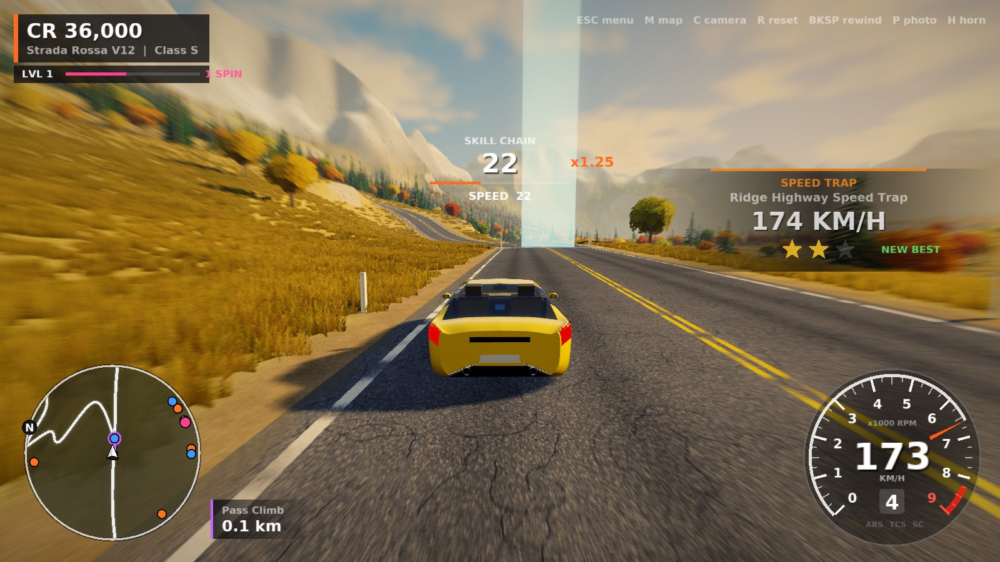
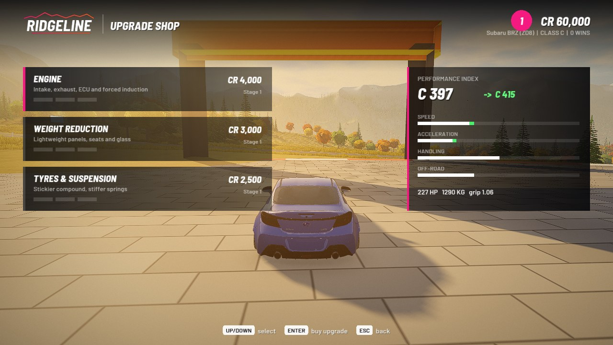
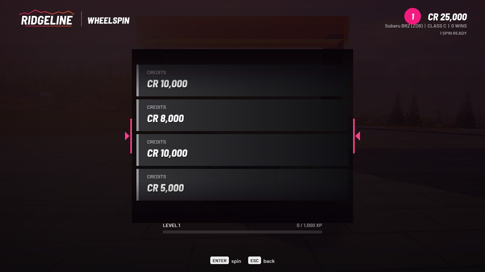
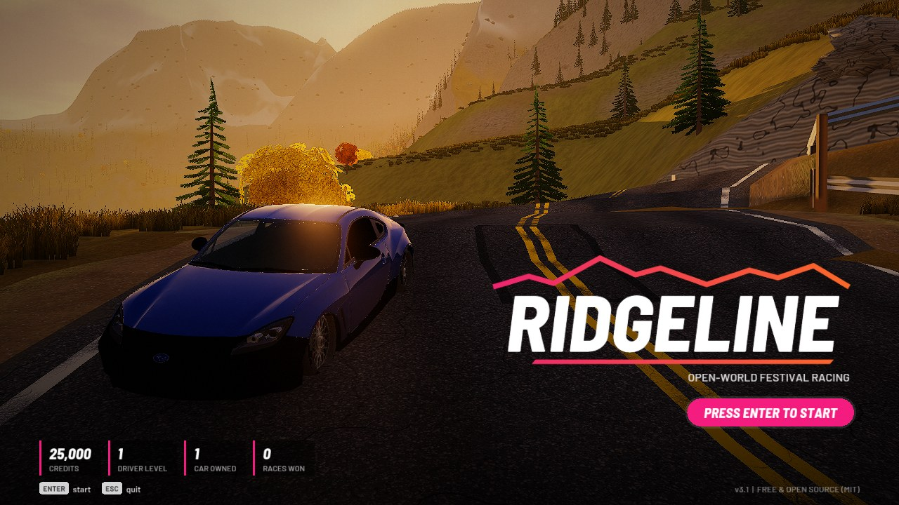

# Ridgeline



**A free, open-source open-world festival racer for Linux.** Drive anywhere across a procedurally generated autumn valley, race AI drivers on highways, mountain passes, dirt trails and open fields, hit speed traps, chain skills, level up for wheelspins, and buy, upgrade, paint and sell cars at the festival.

Written in C++17 with **SDL3** and OpenGL 3.3. No engine and no downloaded assets: every built-in car, texture, tree, road and mountain is generated in code when the game starts. You can also **import your own car models** (FBX or glTF) with the included converter.



| | |
|---|---|
|  |  |
|  |  |
|  |  |
|  |  |

## Features

- **Open world**: a 6 × 6 km island with about 46 km of roads you can leave whenever you want:
  - the original valley with rolling hills, rock cliffs, four lakes and snow-capped mountains,
  - **Neon Bay City**: a street grid with glass towers, neon signs and street lamps,
  - **Harbour Docks**: container stacks, gantry cranes, warehouses and a container ship,
  - the **Coast Highway** around the island, the **Akagi Touge** hairpins up into the northern mountains, and dirt lanes through the western farms,
  - about 260,000 pines and autumn trees, plus scanned rocks, ferns and shrubs.
- **14 race events** with AI drivers: circuits, point-to-point sprints, city and dock circuits, a coast-to-coast run, a touge, a dirt-trail scramble and an off-road cross-country race through checkpoints.
- **EventLab**: build your own race on any road. Pick the start, length or laps, direction, number of rivals, their class and the weather, test drive it and save it to **My Events** (it shows up on the map). Every event has a short **share code** (like `RL1-02000303-07040001-63`): copy it, post it anywhere, and a friend pastes it in with **Import Event**. No server needed, the code is the whole event.
- **Houses**: five homes to buy around the island (Lakeside Cabin, Harvest Farmhouse, Harbour Loft, Summit Lodge, Clifftop Villa). Owning one unlocks fast travel to it, gives a Wheelspin, and its garage opens your car collection.
- **Customization**: eight liveries (twin stripes, contrast roof, two-tone, shoulder stripes, race number roundels, speed slashes, carbon bonnet, split fade) in any colour, your own race number, window tint, aero kits (ducktail, GT wing, GT wing + splitter) and lowered or slammed ride height. Cockpit steering wheels turn up to 180, 360, 540 or 900 degrees lock to lock (setting), on cars whose model has a separate wheel.
- **Smart bots**: they brake for corners based on the road's curvature, overtake by changing lanes, recover when stuck, and use light rubber-banding so races stay close. Your opponents always drive cars from your car's class.
- **Horizon-style progression**:
  - **Skill chains**: drifts, air, speed, big air and near misses build one chain with a rising multiplier. Bank it for credits and XP; crash and it's gone.
  - **XP and levels**: every level earns a **Wheelspin** with credits or a new car.
  - **Speed traps and speed zones** on every highway, with 1 to 3 stars and personal bests.
  - **Upgrade shop**: three stages each of engine, weight reduction and tyres. Upgrades change power, weight, grip, the PI and even the car's class.
  - **Autoshow**: browse cars as rendered cards, compare stats against your current car, pick a paint before buying.
  - **Garage**: switch cars, repaint, add stripes, upgrade and **sell** cars for 60% of their price.
- **Rewind**: hold `Backspace` (or `Y` on a pad) to roll back time, in free roam and in races.
- **Photo mode**: freeze the moment, orbit the car, change the lens, hide the UI and save the shot.
- **GPS**: a road-network route to the event you pick on the world map, or to the nearest unfinished event, with distance.
- **HUD in the style of the 2012 original**: an analogue tachometer with redline and a rim needle, digital speed with dim leading zeros, gear and shift light, ABS/TCS/SC lamps, and a round rotating minimap with white roads, the purple GPS line, opponents, events and PR stunts.
- **10 fictional built-in cars** in 5 classes (D, C, B, A, S), seven community models (the **Subaru BRZ**, **BMW M3 E30**, **Koenigsegg Agera RS**, **Nissan Skyline GT-R R34**, **Daewoo Nexia**, **GMC Motorhome** and the **DeLorean DMC-12 Time Machine**, see [Credits](#credits)), which replace the old built-in placeholder cars, plus any cars you import.
- **Time machine**: hit 88 (mph or km/h, whatever your speedo shows) in the DeLorean for electric arcs, a flash, fire trails and a jump to another era.
- **Quick switch**: press `G` (or D-pad up) while driving to swap to any car you own.
- **Secret car**: there is a hidden code box somewhere in the Autoshow...
- **Driving physics**: a tyre model with slip angles and a friction circle, weight transfer, a 6-speed automatic gearbox, handbrake drifts, jumps and landings, grip that changes between asphalt, dirt, grass and water, and collisions with trees, rocks and other cars. Imported cars use exactly the same physics with their own wheel positions and tyre sizes. Traction control and a stability assist are on by default and can be turned off.
- **Graphics**:
  - **Photo-scanned materials**: CC0 ground, rock, sand and asphalt textures with normal maps, an HDRI sky that also lights the scene (spherical-harmonics ambient), and optional wet roads with puddles and reflections.
  - **Lighting and post**: golden-hour lighting, SSAO, sharpening, two 4096² shadow cascades with soft filtering, HDR bloom, sun shafts, filmic grading and speed-based motion blur.
  - **Water**: lakes with planar reflections, depth-based colour from turquoise shallows to deep water, see-through shallows, waves and shoreline foam.
  - **Roads**: high-resolution procedural asphalt with aggregate, sealed cracks, repair patches, polished tyre lines, dusty edges and worn markings.
  - **Effects**: tyre smoke, dust off-road, water spray and skid marks that stay on the road.
  - **Vegetation**: about 165,000 swaying grass tufts in four distance tiers, so grass doesn't pop in. Pines and autumn trees have distant levels of detail.
  - **Cars**: metallic clearcoat paint. Imported cars use their own textures, normal maps and emissive lights.
- **Menus**: a tabbed festival hub (Festival, Cars, Houses, EventLab, Options; `Q`/`E` or LB/RB) where every tile shows a live render of the world, plus card carousels, stat comparison bars and a wheelspin reel.
- **Cameras**: chase (far and near), cockpit, hood and bumper views, and a free-look orbit with the mouse or right stick.
- **Procedural audio**: an engine synthesised from RPM, throttle and cylinder count, tyre squeal, wind, impacts, a two-tone horn and UI sounds.
- **Keyboard and gamepad** (Xbox, PlayStation, Switch Pro and other SDL-supported controllers), with hot-plugging.
- Saves progress automatically.

## Install

```bash
git clone https://github.com/rxvy-dev/ridgeline.git
cd ridgeline
./install.sh
```

That's it. The installer:

1. Detects your distro and installs build tools with your package manager (it asks for your password through `sudo` or `doas`).
2. Uses your distro's SDL3 package if it has one. If not, it downloads SDL3 3.2 and builds it from source, then bundles it with the game, so it works on older distros too.
3. Builds the game and installs it to `~/.local` (no root needed), with an app-menu entry and an icon.

Then launch **Ridgeline** from your app menu, or run `ridgeline` in a terminal.

**Supported package managers:** `pacman` (Arch, Manjaro, EndeavourOS, CachyOS), `apt` (Debian, Ubuntu, Mint, Pop!_OS), `dnf` (Fedora, Nobara), `zypper` (openSUSE), `xbps` (Void), `emerge` (Gentoo), `apk` (Alpine), `eopkg` (Solus). On NixOS, run it inside `nix-shell -p cmake gcc gnumake pkg-config git sdl3`. On any other distro it works as long as a C++17 compiler, CMake and git are installed.

### Installer options

| Command | What it does |
|---|---|
| `./install.sh` | Install for your user into `~/.local` |
| `./install.sh --system` | Install for everyone into `/usr/local` |
| `./install.sh --prefix DIR` | Install into a custom directory |
| `./install.sh --no-deps` | Don't touch the package manager |
| `./install.sh --bundle-sdl` | Always build and bundle SDL3, even if your distro has it |
| `./install.sh --uninstall` | Remove the game (add `--system` or `--prefix` if you used them) |

### Build manually

```bash
# needs: a C++17 compiler, cmake >= 3.16, SDL3 >= 3.2 development files
cmake -S . -B build -DCMAKE_BUILD_TYPE=Release
cmake --build build -j
./build/ridgeline
```

## Controls

| Action | Keyboard | Gamepad |
|---|---|---|
| Accelerate | `W` / `↑` | Right trigger |
| Brake / reverse | `S` / `↓` | Left trigger |
| Steer | `A` `D` / `←` `→` | Left stick |
| Handbrake | `Space` | `A` / `✕` |
| Start event / enter hub | `Enter` | `Y` / `△` (near an event) |
| Rewind (hold) | `Backspace` | `Y` / `△` |
| Horn | `H` | Left stick click |
| Quick car switch | `G` | D-pad up |
| Photo mode | `P` | Right stick click |
| Look around (orbit the camera) | move the mouse | Right stick |
| Zoom camera | mouse wheel | |
| Change camera (chase far, chase near, cockpit, hood, bumper) | `C` | `RB` / `R1` |
| Look back | hold `B` | hold `B` / `○` |
| Reset to road | `R` | `X` / `□` |
| World map | `M` / `Tab` | `Back` / `Select` |
| Pause menu | `Esc` | `Start` |
| Fullscreen | `F11` | |
| Screenshot (saved next to your save file) | `F12` | |

While driving the mouse is captured for free look. Press `Esc` to get the cursor back.

Menus: arrow keys or D-pad to move, `Enter` or `A` to select, `Esc` or `B` to go back.
- **Autoshow and garage**: `←` `→` pick a car, `↑` `↓` change the paint.
- **Garage**: `U` / `RB` opens upgrades, `X` toggles stripes, and `V` / `Y` sells the selected car (press twice to confirm).
- **World map**: `X` sets a GPS route, and `Enter` fast-travels.
- **Photo mode**: `WASD` orbits, `Q` `E` zoom, `Z` `X` change the lens, `Enter` takes a photo and `H` hides the UI.

## How to play

- The title screen shows your best car parked at a lookout at sunset.
- You start at the **Festival Hub** (pink beacon) with **CR 25,000**, a starter car and one welcome **Wheelspin**. The starter is the **Subaru BRZ**, or any other car marked `starter=1` in its `car.ini`. Cars in your own `cars/` folder take priority. Without any car packs it's the Kito Pulsar hatchback.
- **Events** are the tall coloured light beams: orange for circuits, blue for sprints, green for cross-country. Drive into one, stop, and press `Enter` to race. The purple GPS line leads to the nearest event you haven't won. Pick another target on the **World Map** with `X`, or fast-travel there with `Enter`.
- Finish **1st, 2nd or 3rd** to win the event's prize. Every finish earns XP. Your best result for each event is shown on the map.
- **Skills**: drift, jump, drive flat out above 180 km/h and slip past rivals to build a **skill chain**. Keep doing skills to raise the multiplier. Stop for a couple of seconds and it banks as credits and XP. A crash breaks the chain.
- **Speed traps** (orange boards) record your speed as you pass. **Speed zones** (blue boards) measure your average speed between the two boards. Three stars pay the most, and beating your best gives bonus XP.
- **Level up** to earn Wheelspins, then spin them from the Festival menu.
- Press `Esc` for the **Festival menu**: resume, world map, wheelspin, autoshow, garage (paint, upgrade, sell), **Next Race**, settings, and save & exit.
- Faster cars put you up against faster opponents, because bots always come from your car's class, and upgrades can bump your class up.
- Made a mistake? Hold `Backspace` to rewind. Fell in the lake or stuck in the trees? Press `R`.

### Events

| Event | Type | Notes |
|---|---|---|
| Ridge Highway Circuit | Circuit, 1 lap | The fast highway ring around the valley |
| Ridge Reverse | Circuit, 1 lap | The same ring, counter-clockwise |
| Valley Sprint | Sprint | West to east across the valley floor |
| Lakeshore Sprint | Sprint | The southern highway past the lake |
| Summit Loop | Circuit, 2 laps | A twisting mountain loop up north |
| Pass Climb | Sprint | Switchbacks up to the summit |
| Timberline Scramble | Circuit, 2 laps | A dirt trail through the forest; off-road cars do well here |
| Golden Fields Cross Country | Cross-country | Checkpoints through open meadows |

### Cars

| Car | Class | Price | Drive | Character |
|---|---|---|---|---|
| Kito Pulsar 1.6 | D | starter | FWD | Light, forgiving hatchback |
| Corvo Rallye 2.0 | D | 18,000 | AWD | Rally hatch, great on dirt |
| Bravado Stallion 5.0 | C | 36,000 | RWD | V8 muscle, loves to slide |
| Nordwind Ridgeback TR | C | 42,000 | AWD | Heavy off-roader |
| Kestrel GT-S | B | 64,000 | RWD | Balanced sports coupé |
| Ardent Mantis RT | A | 118,000 | RWD | Brutal front-engine GT |
| Vespera 7 Spyder | A | 142,000 | RWD | Mid-engine, sharp handling |
| Aurex Corsa R | A | 168,000 | AWD | Mid-engine, all-weather grip |
| Strada Rossa V12 | S | 360,000 | RWD | V12 grand tourer |
| Tempest Vortex | S | 1,150,000 | AWD | 880 kW hypercar |

All built-in makes and models are invented for this game.

## Adding your own cars

Ridgeline can drive any car model you're allowed to use. The converter turns a binary **FBX** (7.x) or **glTF 2.0** (`.gltf` / `.glb`) model into the game's `.rcar` format. It needs only Python 3, with no extra packages.

```bash
python3 tools/import_car.py ~/Downloads/mycar/source/car.fbx cars/mycar \
        --textures ~/Downloads/mycar/textures --length 4.4
```

- Wheels are found from part and material names (`tire`, `tyre`, `rim`, `wheel`, `disc`, `hub`, ...) and a geometry check, then split into the four corners. Brake calipers stay fixed. Your car gets the full tyre physics with its own wheel positions and tyre radius.
- Body paint is detected automatically, so the paint shop and the autoshow colour picker work on imported cars.
- `--forward` fixes models that face the wrong way (`+z`, `-z`, `+x`, `-x`).
- `--length` rescales the car to a real length in metres.
- `--max-tex` limits the texture size (default 1024).
- `--drop 'regex'` removes parts you don't want, such as light bars or a driver.
- `--paint 'regex'` marks materials as body paint. On a coloured livery, only the coloured areas get repainted, and carbon, black trim and decals are kept.
- `--no-glass 'regex'` fixes parts wrongly detected as glass, such as a "windshieldwiper".
- Wheels modelled turned are straightened automatically, so the game can steer them itself.
- Tyres named after common brands (Pirelli, Michelin, ADVAN, ...) are recognised. For anything else, `--tires 'regex'` says which parts are tyres, and `--spin 'regex'` adds parts that should rotate with the wheels, such as rim metals with generic names.
- Textures embedded in `.glb` files are extracted automatically. Materials only used by `--drop`ped parts are not packed.
- Edit the generated `cars/mycar/car.ini` to set the name, class, price, power, weight, top speed, drivetrain, grip, cylinders, stock colour, credits, and `starter=1` if you want to start with it.

Put the folder in `~/.local/share/rxvy/ridgeline/cars/` to use it right away. You can also keep packs in `cars/` next to `install.sh`, and `./install.sh` installs them along with the game. Imported cars appear in the autoshow and wheelspins, and you can paint, upgrade, sell and race them like any other car.

**Licensing:** other model files are git-ignored (`cars/`, `*.rcar`, `*.fbx` and `*.glb`), so only models whose licence allows sharing get committed here. `cars/agera_rs`, `cars/brz_2022`, `cars/delorean` and `cars/m3_e30` are the exceptions and come with their own licences. Only import models whose licence allows it, and keep their credit line in `car.ini`; it is shown in the autoshow.

## Settings

Speed units (km/h or mph), motion blur, shadows, anti-aliasing (off, 2x, 4x, 8x MSAA), draw distance (Low, Medium, High, Ultra), fullscreen, V-Sync, volume, driving assists and grass (off, near only, full distance). Lake reflections are on from Medium draw distance up. New installs start on Ultra with 8x MSAA, which suits an RTX 30-series or newer. On weaker GPUs, set grass to "near only", draw distance to Medium and anti-aliasing to 4x.

## Requirements

- Linux on x86_64 or ARM64, with X11 or Wayland
- A GPU with **OpenGL 3.3**. A dedicated GPU is recommended for High draw distance. Integrated graphics run well with grass and shadows off.
- About 500 MB of RAM

Your save file, screenshots (`F12`), photo-mode shots and imported cars (`cars/`) are in `~/.local/share/rxvy/ridgeline/`.

## Troubleshooting

- **"Could not start the game / OpenGL 3.3"**: update your Mesa or GPU drivers. In a VM, enable 3D acceleration.
- **Black window or crash on Wayland**: try `SDL_VIDEO_DRIVER=x11 ridgeline`.
- **No sound**: SDL3 picks PipeWire, PulseAudio or ALSA automatically. Try `SDL_AUDIO_DRIVER=pulseaudio ridgeline`.
- **SDL3 build failed in the installer**: install your distro's X11/Wayland/Mesa *development* packages (the installer prints the list) and run `./install.sh` again, or use `--bundle-sdl`.
- **`ridgeline: command not found`**: add `~/.local/bin` to your `PATH`, or start it from the app menu.

## Project layout

```
src/
  main.cpp       command line and entry point
  game.*         state machine, menus, races, camera, HUD, saving
  features.cpp   skill chains, XP/levels, wheelspin, speed traps/zones, rewind, photo mode, upgrades
  effects.*      tyre smoke, dust, spray and skid marks
  gps.*          road graph and Dijkstra routing for the GPS
  carimport.*    loader for imported .rcar car packs
  inflate.*      small zlib decoder for car textures
  world.*        terrain, roads, forests, lake, festival hub, map texture
  cars.*         car database and procedural car and wheel meshes
  vehicle.*      car physics (tyres, gearbox, terrain, collisions)
  race.*         events, routes, AI drivers, progress tracking
  render.*       shaders, meshes, instancing + LOD, shadow cascades, bloom, post-processing
  textures.*     procedural texture generator (grass, rock, asphalt, bark, needles, leaves)
  shaders.h      all GLSL shaders
  hud.*          2D drawing and text
  audio.*        procedural engine and effects synth
  gl.*           tiny OpenGL 3.3 function loader
  font_atlas.h   embedded font (generated by tools/gen_font.py)
tools/
  import_car.py  FBX / glTF -> .rcar car converter (pure Python)
  fbxparse.py    binary FBX reader used by the converter
  gen_font.py    font atlas generator
install.sh       cross-distro installer
packaging/       .desktop entry, SVG icon and PNG icons (16-512 px)
```

The world is generated from a fixed seed, so everyone drives the same valley. Developer flags (`ridgeline --help`) can jump straight into a scene, fast-forward the simulation and save screenshots. `--scene bench` runs every car around a route with the AI and prints lap statistics, which is useful for tuning physics.

## Contributing

Pull requests are welcome: new built-in cars (add an entry to `kCars` in `src/cars.cpp`), new events (`buildEvents` in `src/race.cpp`), new roads (`World::generate`), new PR stunts (`Game::buildStunts`), better physics, sound or visuals. Please don't submit third-party car models.

## Credits

- **Subaru BRZ (ZD8)** (`cars/brz_2022/`): based on ["Subaru BRZ 2022"](https://sketchfab.com/models/d079f59271df4702bcfdd449ec8241c1) by [mixmamo.studio](https://sketchfab.com/mixmamo.studio), licensed under [CC BY 4.0](http://creativecommons.org/licenses/by/4.0/). It was converted to `.rcar`, re-oriented, rescaled, given split wheels and paintable bodywork, and a display base plus one borrowed component were removed. That folder is CC BY 4.0.
- **BMW M3 (E30)** (`cars/m3_e30/`): based on ["[FREE] BMW M3 E30"](https://sketchfab.com/3d-models/free-bmw-m3-e30-ac3c7013434e403e8faff87948caf422) by [Martin Trafas](https://sketchfab.com/Bexxie), licensed under [CC BY 4.0](http://creativecommons.org/licenses/by/4.0/). It was converted to `.rcar`, rescaled, given split wheels, and its modelled front-wheel steering was straightened. That folder is CC BY 4.0.
- **Koenigsegg Agera RS** (`cars/agera_rs/`): based on ["Koenigsegg Agera RS"](https://sketchfab.com/3d-models/koenigsegg-agera-rs-a30e098257254fcfa1323f2841e26d13) by [RongstadJ](https://sketchfab.com/RongstadJ), licensed under [CC BY 4.0](http://creativecommons.org/licenses/by/4.0/). It was converted to `.rcar`, rescaled, given split wheels and a repaintable livery. That folder is CC BY 4.0.
- **Nissan Skyline GT-R R34** (`cars/skyline_r34/`): based on ["GTR-r34"](https://sketchfab.com/3d-models/gtr-r34-f040d64eefbb41fc9766aef2fd1f0f0a) by [ARjun.JS](https://sketchfab.com/ARjun.JS), licensed under [CC BY 4.0](http://creativecommons.org/licenses/by/4.0/). Converted to `.rcar`, rescaled, ground plane and suspension mesh removed, front wheels straightened and split. That folder is CC BY 4.0.
- **Daewoo Nexia** (`cars/daewoo_nexia/`): based on ["Small price car"](https://sketchfab.com/3d-models/small-price-car-67c84e4d30ae42fda22c0a0c7526df26) by [Oliv1e](https://sketchfab.com/Oliv1e), licensed under [CC BY 4.0](http://creativecommons.org/licenses/by/4.0/). Converted to `.rcar`, rescaled, wheels split. That folder is CC BY 4.0.
- **GMC Motorhome** (`cars/gmc_motorhome/`): based on ["FREE GMC Motorhome reimagined low poly"](https://sketchfab.com/3d-models/free-gmc-motorhome-reimagined-low-poly-6hiH0iyDqXqtdD9wbqSbyLLhKmz) by [Karol Miklas](https://sketchfab.com/karolmiklas), licensed under [CC BY 4.0](http://creativecommons.org/licenses/by/4.0/). Converted to `.rcar`, rescaled, wheels split. That folder is CC BY 4.0.
- **Secret cat** (`cars/oiia_cat/`): based on ["Oiiaioooooiai Cat"](https://sketchfab.com/3d-models/oiiaioooooiai-cat-30d27bf7fb224849b76e208a6eccdb36) by [Zhuier](https://sketchfab.com/Zhuier), licensed under [CC BY 4.0](http://creativecommons.org/licenses/by/4.0/). Converted to `.rcar` and given invisible contact points. That folder is CC BY 4.0. The meme song isn't included, since it isn't ours to share. Drop an `oiia.mp3` (or `.wav`) into that folder and the cat plays it while it spins.
- **Textures, sky and scanned props** (`assets/`): from [Poly Haven](https://polyhaven.com), **CC0** (public domain). The full list is in [`assets/CREDITS.md`](assets/CREDITS.md). Shared prop textures are stored once in `assets/props/_tex/` by `tools/dedupe_props.py`.
- **UI font**: [Barlow](https://github.com/jpt/barlow) by Jeremy Tribby, SIL Open Font License 1.1 (`assets/fonts/OFL.txt`), baked into `src/font_atlas.h` by `tools/gen_font.py`.
- **DeLorean DMC-12 Time Machine** (`cars/delorean/`): based on ["1985 DeLorean DMC-12 Time Machine (BTTF)"](https://sketchfab.com/3d-models/1985-delorean-dmc-12-time-machine-bttf-6fdfe2e2adba4886b48cc523871e88be) by [VTX](https://sketchfab.com/VTX_car), licensed under [CC BY-NC-SA 4.0](http://creativecommons.org/licenses/by-nc-sa/4.0/). It was converted to `.rcar`, rescaled and given split wheels. That folder is CC BY-NC-SA 4.0, not MIT, and is for non-commercial use only. The credit is also shown in the in-game autoshow.
- **Font**: DejaVu Sans Bold.
- **SDL3** by the SDL contributors (zlib licence), bundled by the installer when your distro has no SDL3 package.

## License

The code is MIT, see [LICENSE](LICENSE). `cars/agera_rs/`, `cars/brz_2022/` and `cars/m3_e30/` are CC BY 4.0, and `cars/delorean/` is CC BY-NC-SA 4.0; see the `LICENSE.txt` in each folder. The embedded font is DejaVu Sans Bold (Bitstream Vera / DejaVu license).

Ridgeline is an independent fan project inspired by open-world festival racing games. It is not affiliated with, endorsed by or connected to any commercial racing game, publisher or car manufacturer, and it contains no assets from any of them. Car models you import yourself remain under their own licences and are not part of this project.
